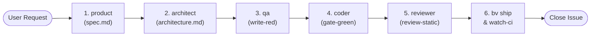

# BV-OS Issue Orchestrator Skill (`orchestrate-issue`)

This skill coordinates the full end-to-end lifecycle for a GitHub issue using deterministic verbs (`bv <verb>`) and specialized subagents.

The root agent operates strictly as an **orchestrator**: it never authors tests, edits source code, or performs audits directly.

---

## 1. Intake & Issue Resolution

1. **Extract Target Issue:**
   - Parse the issue number `<id>` and repository from the user's input or URL.
   - If only an issue number is given (e.g. `74`), detect the repository from `git remote get-url origin` or default to the blueprint repository (`reymundolopez/bv-blueprint`).

2. **Fetch Issue Description Automatically:**
   Run `gh issue view` to inspect the full requirements, labels, and discussion:
   ```bash
   gh issue view <id> -R <repo>
   ```

3. **Initialize the Issue State Machine:**
   Start the issue to create `.bv/state/ISSUE-<id>.json`, activate the session lock, and checkout the feature branch:
   ```bash
   bv start-issue <id>
   ```

4. **Verify Ledger:**
   ```bash
   bv ledger
   ```

---

## 2. Orchestration Protocol (Sequential Subagents)

Never skip phases. Always invoke subagents in the following exact order:



### Phase 1: Product (`product` subagent)
- **Role:** Product Manager / Spec Writer.
- **Task:** Formulate clear scope, non-goals, and unambiguous Acceptance Criteria (ACs).
- **Packet:** `.bv/packets/ISSUE-<id>/spec.md`
- **Action:** Transition phase with `bv set-phase spec`, invoke `product` subagent, and publish the spec comment:
  ```bash
  bv post-comment spec
  ```

### Phase 2: Architecture (`architect` subagent)
- **Role:** Technical Architect.
- **Task:** Formulate technical design, component boundaries, dependency changes, and architectural constraints.
- **Packet:** `.bv/packets/ISSUE-<id>/architecture.md`
- **Action:** Transition phase with `bv set-phase architecture`, invoke `architect` subagent, and publish the architecture comment:
  ```bash
  bv post-comment architecture
  ```

### Phase 3: QA Acceptance (`qa` subagent)
- **Role:** QA Acceptance Engineer.
- **Task:** Author failing (RED) acceptance tests based strictly on the spec's ACs.
- **Constraint:** Must NEVER edit `apps/**` or `packages/**` source code.
- **Packet:** `.bv/packets/ISSUE-<id>/red.md`
- **Locking:** Author tests and lock with `bv write-red <test-file>`.
- **Action:** Transition phase with `bv set-phase red`, invoke `qa` subagent, verify tests fail, and post red comment:
  ```bash
  bv post-comment red
  ```

### Phase 4: Implementation (`coder` subagent)
- **Role:** Full-Stack Developer.
- **Task:** Implement minimal, clean code changes under `apps/**` and `packages/**` to turn the locked RED tests green.
- **Constraint:** Must NEVER modify locked RED test files, `scripts/**`, or `.agents/**`.
- **Packet:** `.bv/packets/ISSUE-<id>/code.md`
- **Verification:** Ensure `bv gate-green` passes cleanly.
- **Action:** Transition phase with `bv set-phase code`, invoke `coder` subagent, verify tests pass, and post green comment:
  ```bash
  bv post-comment green
  ```

### Phase 5: Audit & Static Review (`reviewer` subagent)
- **Role:** Code Reviewer.
- **Task:** Audit branch diff against architecture rules, code hygiene, and style guidelines.
- **Packet:** `.bv/packets/ISSUE-<id>/review.md`
- **Verification:** Run `bv review-static`.
- **Action:** Transition phase with `bv set-phase review`, invoke `reviewer` subagent, and post review comment:
  ```bash
  bv post-comment review
  ```

---

## 3. Deterministic Verification & Shipping

Once review is approved:

1. **Local Test Suite:**
   ```bash
   bv verify
   ```
2. **Pre-push Hygiene & Secret Gate:**
   ```bash
   bv prepush
   ```
3. **Ship Branch & Create/Update PR:**
   ```bash
   bv ship --push --message "feat(issue-<id>): <summary>"
   ```
4. **Monitor GitHub Actions CI:**
   ```bash
   bv watch-ci
   ```
5. **Verify Live Deployment:**
   ```bash
   bv verify-prod
   ```
6. **Close Issue & Release Locks:**
   ```bash
   bv close-issue
   ```

---

## 4. Alternative CLI Execution

If the user requests fully automated or headless execution:
```bash
bv run-issue <id> --with-spec --with-design --deep-review
```
