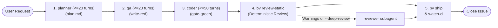

# BV-OS Issue Orchestrator Skill (`orchestrate-issue`)

This skill coordinates the end-to-end lifecycle for a GitHub issue using deterministic verbs (`bv <verb>`) and specialized subagents.

> [!TIP]
> **Preferred Execution Mode:** For issues with established acceptance criteria, recommend running headless execution:
> ```bash
> bv run-issue <id>
> ```
> This executes all deterministic gates in a single synchronous process with **0 LLM tokens and 0 conversational turns**.

The root agent operates strictly as an **orchestrator**: it never authors tests, edits source code, or performs manual audits directly.

---

## 1. Intake & Issue Resolution

1. **Extract Target Issue:**
   - Parse the issue number `<id>` and repository from the user's input or URL.
   - If only an issue number is given (e.g. `74`), detect the repository from `git remote get-url origin` or default to the blueprint repository (`reymundolopez/bv-blueprint`).

2. **Fetch Issue Description Automatically:**
   Run `gh issue view` or `bv read-issue <id>` to inspect requirements and ACs:
   ```bash
   bv read-issue <id>
   ```

3. **Initialize the Issue State Machine:**
   Start the issue to create `.bv/state/ISSUE-<id>.json`, activate the session lock, and checkout the feature branch:
   ```bash
   bv start-issue <id>
   ```

4. **Verify Ledger:**
   ```bash
   bv ledger --issue <id>
   ```

---

## 2. Orchestration Protocol (Sequential Subagents & Deterministic Gates)

Never skip phases. Execute phases in order:



### Phase 1: Planning (`planner` subagent, budget <= 20 turns)
- **Role:** Systems Architect & Product Planner.
- **Task:** Unify scope and technical architecture into `.bv/packets/ISSUE-<id>/plan.md` with:
  - **Section 1: Black-Box Acceptance Criteria** (falsifiable expected outputs).
  - **Section 2: White-Box Technical Blueprint** (affected modules, APIs, route/proxy changes, architectural constraints).
- **Rule:** Batch AST reads with `bv read-slice` and `bv outline`. Do NOT issue unbatched single-file micro-reads.
- **Packet:** `.bv/packets/ISSUE-<id>/plan.md`
- **Action:** Transition phase with `bv set-phase plan --issue <id>`, invoke `planner` subagent, and publish the plan comment:
  ```bash
  bv post-comment plan --issue <id>
  ```

### Phase 2: QA Acceptance (`qa` subagent, budget <= 20 turns)
- **Role:** QA Acceptance Engineer.
- **Task:** Author failing (RED) acceptance tests based strictly on `plan.md` Section 1 ACs.
- **Constraint:** Must NEVER edit `apps/**` or `packages/**` source code. Batch reads via `bv read-slice`.
- **Packet:** `.bv/packets/ISSUE-<id>/red.md`
- **Locking:** Author tests and lock with `bv write-red <test-file> --issue <id>`.
- **Action:** Transition phase with `bv set-phase red --issue <id>`, invoke `qa` subagent, verify tests fail, and post red comment:
  ```bash
  bv post-comment red --issue <id>
  ```

### Phase 3: Implementation (`coder` subagent, budget <= 50 turns)
- **Role:** Full-Stack Developer.
- **Task:** Implement minimal, clean code changes under `apps/**` and `packages/**` to turn the locked RED tests green.
- **Constraint:** Must NEVER modify locked RED test files of the active issue, `scripts/**`, or `.agents/**`. Historical regression tests whose requirements have been intentionally superseded can be maintained and updated only as part of explicit architectural maintenance issues.
- **Rule:** Batch reads via `bv read-slice`. Avoid unbatched micro-reads.
- **Packet:** `.bv/packets/ISSUE-<id>/code.md`
- **Verification:** Ensure `bv gate-green --issue <id>` passes cleanly.
- **Action:** Transition phase with `bv set-phase code --issue <id>`, invoke `coder` subagent, verify tests pass, and post green comment:
  ```bash
  bv post-comment green --issue <id>
  ```

### Phase 4: Deterministic Review Gate & Optional Deep Review
- **Default (Deterministic Mode):** Per `sdlc.config.json`, the review phase executes deterministically:
  1. Transition phase:
     ```bash
     bv set-phase review --issue <id>
     ```
  2. Run static review:
     ```bash
     bv review-static --issue <id>
     ```
  3. If static review passes cleanly (exit 0, no warnings), publish the review comment directly:
     ```bash
     bv post-comment review --issue <id>
     ```
- **Deep Review Mode (`reviewer` subagent):**
  - Spawn the `reviewer` subagent **only** if:
    a) `bv review-static` returns non-zero / flags architectural warnings, OR
    b) The user explicitly requested `--deep-review`.
  - The subagent audits the branch diff, writes `.bv/packets/ISSUE-<id>/review.md`, and runs `bv post-comment review --issue <id>`.

---

## 3. Deterministic Verification & Shipping

Once review is approved:

1. **Local Test Suite:**
   ```bash
   bv verify --issue <id>
   ```
2. **Pre-push Hygiene & Secret Gate:**
   ```bash
   bv prepush --issue <id>
   ```
3. **Ship Branch & Create/Update PR:**
   ```bash
   bv ship --push --message "feat(issue-<id>): <summary>" --issue <id>
   ```
4. **Monitor GitHub Actions CI:**
   ```bash
   bv watch-ci
   ```
5. **Verify Live Deployment:**
   ```bash
   bv verify-prod
   ```
6. **Close Issue & Release Locks:**
   ```bash
   bv close-issue --issue <id>
   ```

---

## 4. Alternative CLI Execution

If the user requests fully automated or headless execution:
```bash
bv run-issue <id> --deep-review
```
